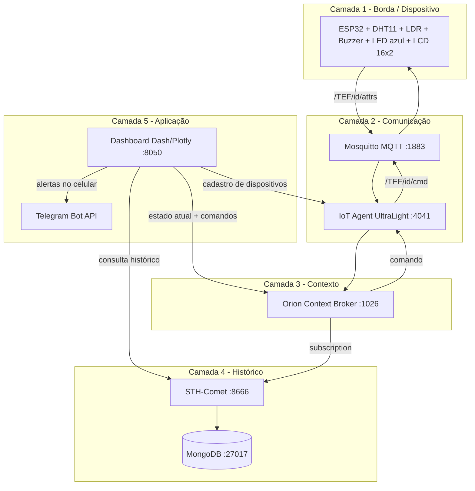

# 🍷 Vinheria Full — Monitoramento global de adegas (CP5)

**Integrantes:** _(preencher: nome completo + RM de cada integrante)_
**Disciplina:** _(preencher)_  |  **Professor:** Prof. Dr. Fábio Henrique Cabrini
**Hands-on:** 30/10/2026  |  **Simulação Wokwi:** _(colar link)_  |  **Vídeo:** _(colar link)_

---

## 1. Descrição da solução

Vinhos são sensíveis a temperatura, umidade e luz. A **Vinheria Full** monitora esses três parâmetros em adegas ao redor do mundo com um **ESP32** equipado com **DHT11** (temperatura/umidade) e **LDR** (luminosidade), enviando os dados à plataforma **FIWARE**.

Um **dashboard web** permite:

- **Cadastrar e gerenciar dispositivos IoT** (provisionamento no IoT Agent, com local e coordenadas);
- **Acompanhar o estado atual** de cada adega em cartões e em um **mapa**;
- **Analisar o histórico** em gráficos dinâmicos alimentados pelo **STH-Comet (porta 8666)**;
- **Ajustar os triggers** (mínimo/máximo) de temperatura, umidade e luminosidade por dispositivo;
- **Escolher o tipo de vinho** (tinto, branco, rosé, espumante) para preencher os triggers automaticamente;
- **Receber alertas no celular** (Telegram) e consultar/baixar o **histórico de alertas** (CSV);
- **Disparar alertas remotos**: quando um parâmetro sai do trigger, o front-end envia um comando ao ESP32. O **LED azul** pisca, o **buzzer** toca um som **diferente para cada anomalia** e o **LCD 16x2** mostra qual alerta está ativo, tudo até o valor voltar ao normal.

| Anomalia | Comando | Som do buzzer | LED azul |
|---|---|---|---|
| Temperatura | `alertTemp` | 1 beep agudo curto (2000 Hz) | pisca |
| Umidade | `alertHum` | 2 beeps médios (1200 Hz) | pisca |
| Luminosidade | `alertLux` | 1 tom longo grave (500 Hz) | pisca |

Se houver mais de uma anomalia, os sons se alternam a cada 3 s. Ao normalizar, o dashboard envia `clearTemp` / `clearHum` / `clearLux`.

## 2. Arquitetura em camadas



| Camada | Componentes | Responsabilidade |
|---|---|---|
| 1. Borda | ESP32, DHT11, LDR, buzzer, LED, LCD | Ler sensores, publicar, executar alertas e mostrar status no LCD (sem `delay`, via `millis`) |
| 2. Comunicação | Mosquitto, IoT Agent UL | Transporte MQTT e tradução UltraLight ⇄ NGSI v2 |
| 3. Contexto | Orion | Estado atual das entidades `urn:ngsi-ld:Vinheria:NNN` e roteamento de comandos |
| 4. Histórico | STH-Comet, MongoDB | Séries temporais (via subscription do Orion) |
| 5. Aplicação | Dashboard Dash, Telegram | Cadastro, gráficos, triggers, perfis de vinho, motor de alertas, mapa, notificações e histórico |

**Ciclo de alerta:** leitura fora do trigger → dashboard faz `PATCH /v2/entities/<id>/attrs` com o comando → Orion → IoT Agent → MQTT `/TEF/<id>/cmd` → ESP32 pisca o LED e toca o buzzer → ESP32 responde em `/cmdexe`. O dashboard reenvia o comando a cada 30 s enquanto a anomalia persistir (resiliência a reinício do ESP32).

## 3. Estrutura do repositório

```
vinheria-full/
├── firmware/vinheria_esp32/vinheria_esp32.ino   # código do ESP32
├── wokwi/                                        # diagram.json, libraries.txt, instruções
├── fiware/docker-compose.yml, setup.sh           # infraestrutura FIWARE
├── dashboard/app.py, requirements.txt, assets/   # front-end + motor de alertas + Telegram
├── impressao_3d/                                 # STLs do barril (corpo + tampa) e LEIA-ME de montagem
└── docs/                                         # prints, vídeo, fotos do encapsulamento
```

## 4. Manual de instalação

### 4.1 Hardware

**Materiais:** ESP32 DevKit v1, DHT11, LDR, resistor 10 kΩ, buzzer ativo ou passivo, display LCD 16x2 com adaptador I2C, protoboard, jumpers, cabo USB.

| Componente | Pino do componente | Pino do ESP32 |
|---|---|---|
| DHT11 | VCC / DATA / GND | 3V3 / **GPIO15** / GND |
| LDR | uma perna | 3V3 |
| LDR + resistor 10 kΩ | junção (ponto médio) | **GPIO34** |
| Resistor 10 kΩ | outra ponta | GND |
| Buzzer | + / − | **GPIO18** / GND |
| LED azul | onboard | **GPIO2** (já na placa) |
| LCD 16x2 (I2C) | VCC / GND / SDA / SCL | **VIN (5 V)** / GND / **GPIO21** / **GPIO22** |

> Com o LDR no 3V3 e o resistor no GND, **mais luz = valor maior**. Se o seu for o inverso, defina `LDR_INVERTIDO = true` no firmware.
> Se o DHT11 não tiver resistor pull-up embutido (módulo de 3 pinos já tem), coloque 10 kΩ entre DATA e VCC.

### 4.2 Servidor FIWARE (máquina ou VM com Docker)

```bash
cd fiware
docker compose up -d
docker compose ps          # os 5 containers devem estar "running"
```

Libere no firewall/NSG as portas **1883** (MQTT), **1026**, **4041**, **8666** e **8050**.
O dashboard já cria o *service group* e a *subscription* do STH-Comet ao iniciar. Se preferir manualmente: `./setup.sh <IP_DO_SERVIDOR>`.

### 4.3 Dashboard

```bash
cd dashboard
python -m venv .venv && source .venv/bin/activate     # Windows: .venv\Scripts\activate
pip install -r requirements.txt
export FIWARE_HOST=<IP_DO_SERVIDOR>                   # Windows: set FIWARE_HOST=...
python app.py                                          # abra http://localhost:8050
```

### 4.4 Firmware

1. Arduino IDE → instale o pacote **esp32 (Espressif)** e as bibliotecas **PubSubClient**, **DHT sensor library**, **Adafruit Unified Sensor** e **LiquidCrystal I2C**.
2. Abra `firmware/vinheria_esp32/vinheria_esp32.ino` e ajuste `WIFI_SSID`, `WIFI_PASSWORD`, `MQTT_BROKER` (IP do servidor) e `DEVICE_ID` (igual ao ID cadastrado no dashboard, ex.: `vinho001`). Se o LCD não acender, troque `LCD_ADDR` de `0x27` para `0x3F`.
3. Placa **ESP32 Dev Module** → gravar → Serial Monitor a 115200.

## 5. Manual de operação

1. Abra o dashboard → aba **Dispositivos** → informe número (ex.: `001`), vinheria, local, latitude, longitude e o **tipo de vinho** → **Cadastrar**. O ID gerado é `vinho001` (entidade `urn:ngsi-ld:Vinheria:001`).
2. Ligue o ESP32. No Serial Monitor devem aparecer `[PUB] t|..|h|..|l|..` a cada 5 s.
3. Aba **Triggers** → selecione o dispositivo → escolha um **perfil de vinho** e clique em **Aplicar perfil** (ou ajuste mínimo/máximo à mão e **Salvar triggers**) (valem no próximo ciclo de 5 s).
4. Aba **Monitoramento** → cartões e mapa mostram o estado; em alerta o cartão fica laranja.
5. Aba **Gráficos históricos** → escolha dispositivo e janela (30 a 1000 leituras). As linhas tracejadas são os triggers.
6. **Demonstração:** em **Monitoramento**, use *Testar temperatura/umidade/luminosidade* para ouvir cada som e *Silenciar tudo* para parar. Para o teste real: aqueça o DHT11 com a mão (temperatura), sopre (umidade) ou cubra/ilumine o LDR (luminosidade) e veja o LED azul piscar até normalizar.

### Alertas no celular (Telegram) — opcional

1. No Telegram, converse com **@BotFather** → `/newbot` → guarde o **token**.
2. Abra uma conversa com o seu bot e envie qualquer mensagem (ex.: `oi`).
3. Descubra seu **chat id** abrindo no navegador `https://api.telegram.org/bot<TOKEN>/getUpdates` e procurando `"chat":{"id": ...}`.
4. Inicie o dashboard com as variáveis definidas:

```bash
export TELEGRAM_BOT_TOKEN=<TOKEN>
export TELEGRAM_CHAT_ID=<CHAT_ID>
python app.py
```

Na aba **Alertas** use **Enviar mensagem de teste**. A partir daí o celular recebe uma mensagem quando um parâmetro sai do limite e outra quando normaliza (sem repetir a cada ciclo). A mesma aba mostra o **histórico de alertas** e o botão **Baixar histórico (CSV)**. Sem as variáveis, o dashboard funciona normalmente, só não envia mensagens.

> Os perfis de vinho usam faixas de referência aproximadas para armazenamento (ex.: tinto 12–18 °C, branco 8–12 °C, espumante 6–10 °C). Confirme com o produtor e ajuste na aba Triggers se necessário.

### Solução de problemas

| Sintoma | Verifique |
|---|---|
| Dashboard diz "FIWARE indisponível" | `FIWARE_HOST` correto? `docker compose ps`? portas liberadas? |
| ESP32 não publica | IP do broker, `DEVICE_ID` cadastrado, `mosquitto` no ar (`docker logs mosquitto`) |
| Gráficos vazios | Subscription criada (`GET :1026/v2/subscriptions`), dispositivo enviando, aguarde 1–2 leituras |
| Alerta não toca | Comando chegou? (`[CMD]` no Serial). O dispositivo foi cadastrado pelo dashboard (com os comandos)? |
| LCD sem texto | Endereço I2C (`0x27` ou `0x3F`), contraste (parafuso azul do adaptador), alimentação em 5 V (VIN), SDA/SCL em GPIO21/22 |
| DHT11 com `NaN` | Fio de dados no GPIO15, alimentação 3V3, aguarde 2 s após ligar |

## 6. Consultas úteis (API)

```bash
# Histórico no STH-Comet (porta 8666)
curl -H "fiware-service: smart" -H "fiware-servicepath: /" \
  "http://<IP>:8666/STH/v1/contextEntities/type/Vinheria/id/urn:ngsi-ld:Vinheria:001/attributes/temperature?lastN=20"

# Estado atual no Orion
curl -H "fiware-service: smart" -H "fiware-servicepath: /" \
  "http://<IP>:1026/v2/entities/urn:ngsi-ld:Vinheria:001?options=keyValues"
```

## 7. Diferenciais implementados

- **LCD 16x2 no produto:** mostra temperatura, umidade, luminosidade e o alerta ativo, mesmo sem o computador por perto;
- **Alertas no celular (Telegram)** na transição de alerta e de normalização, sem repetir mensagem;
- **Perfis de vinho** (tinto, branco, rosé, espumante) que preenchem os triggers com um clique;
- **Histórico de alertas** na tela e exportação em **CSV**;
- Mapa global das vinherias com status por cor;
- Triggers independentes por dispositivo e persistidos;
- Reenvio automático do alerta e limpeza individual por parâmetro;
- Firmware não bloqueante, com reconexão MQTT/WiFi automática;
- Encapsulamento em barril impresso em 3D (`impressao_3d/`): corpo + tampa com display, aberturas para LDR, DHT11, buzzer e cabo USB.

## 8. Checklist de entrega

- [ ] Link do GitHub (`.ino`, dashboard comentado, `requirements.txt`, README) no Forms
- [ ] Nomes dos integrantes preenchidos neste README
- [ ] Link do Wokwi (DHT22 + LDR) no Forms
- [ ] Vídeo da demonstração
- [ ] Encapsulamento da solução pronto para o hands-on (30/10/2026)
- [ ] Bot do Telegram criado e testado (opcional, mas faz parte do pitch)

## 9. Roteiro sugerido de pitch (hands-on, 40% da nota)

1. **Problema** (30 s): adegas perdem lotes por variações de temperatura, umidade e luz.
2. **Solução e arquitetura** (1 min): mostre o diagrama em camadas.
3. **Demo ao vivo** (3 min): cadastrar dispositivo → dados chegando → alterar trigger → provocar anomalia → LED azul + som → normalizar e ver parar → gráfico histórico.
4. **Diferenciais e encapsulamento** (1 min): LCD no produto, mensagem no celular, perfis de vinho, barril impresso.
5. **Próximos passos** (30 s).
